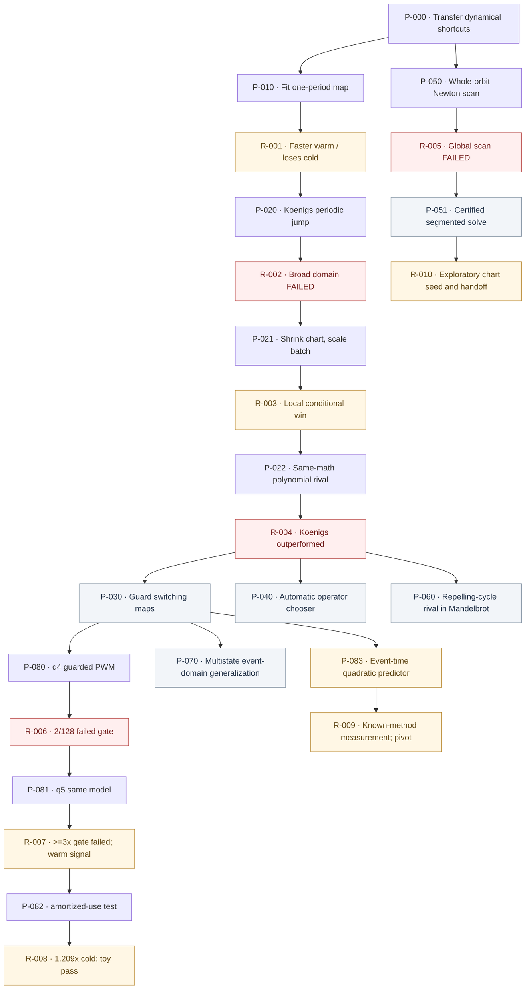

# Research lineage map

Arrows mean **motivated or tested**, not proof of mathematical implication. A failed *preregistered gate* is not a verdict that all measured gains are worthless: R-007 failed its 3× single-cold target but R-008 retained a separately tested 1.209× amortized improvement. New workload/competitor/gates require linked questions, never silent rewriting.

## Clickable reading order

[P-000](PROMPTS/P-000.md) → [P-010](PROMPTS/P-010.md) → [R-001](RESULTS/R-001.md) → [P-020](PROMPTS/P-020.md) → [R-002](RESULTS/R-002.md) → [P-021](PROMPTS/P-021.md) → [R-003](RESULTS/R-003.md) → [P-022](PROMPTS/P-022.md) → [R-004](RESULTS/R-004.md) → [P-030](PROMPTS/P-030.md).

Parallel track: [P-050](PROMPTS/P-050.md) → [R-005](RESULTS/R-005.md) → [P-051](PROMPTS/P-051.md).

Questions branching from the composition result: [P-040](PROMPTS/P-040.md), [P-060](PROMPTS/P-060.md). Measured negative branch: [P-080](PROMPTS/P-080.md) → [R-006](RESULTS/R-006.md) → [P-081](PROMPTS/P-081.md) → [R-007](RESULTS/R-007.md) (accuracy repaired; old ≥3× gate failed, 2.027× warm signal retained) → [P-082](PROMPTS/P-082.md) → [R-008](RESULTS/R-008.md) (1.209x cold synthetic workload gain). Future multi-state extension: [P-070](PROMPTS/P-070.md).

New pretest branch: [P-030](PROMPTS/P-030.md) → [P-083](PROMPTS/P-083.md) ([PA-P-083](PRIOR_ART/PA-P-083.md)) → [R-009](RESULTS/R-009.md) (historical warm-only gain; **known-method research CLOSED/PIVOT**, no default tuning child). Search-only future prior-art matches go straight to a documented [frontier](FRONTIER.md) pivot, without a forced P/R edge.

[All statuses and one-line decisions](INDEX.md).

Executed exploratory child: [P-051](PROMPTS/P-051.md) → [R-010](RESULTS/R-010.md), conditional exact-initial-condition chart seeding, nonsequential defect budget, and failed out-of-range chart evaluation. Not a certified time-parallel solver or speedup.
