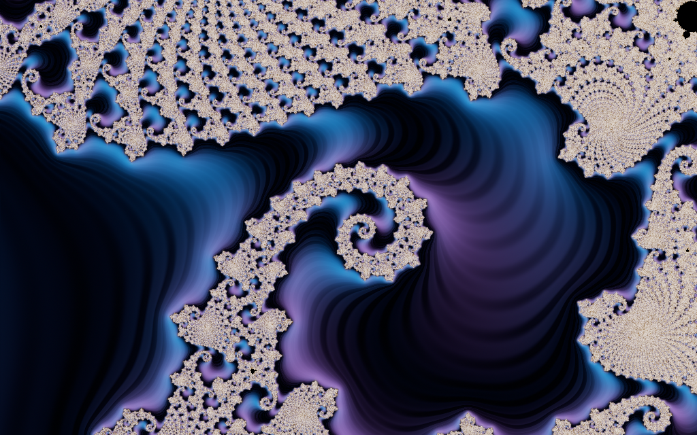
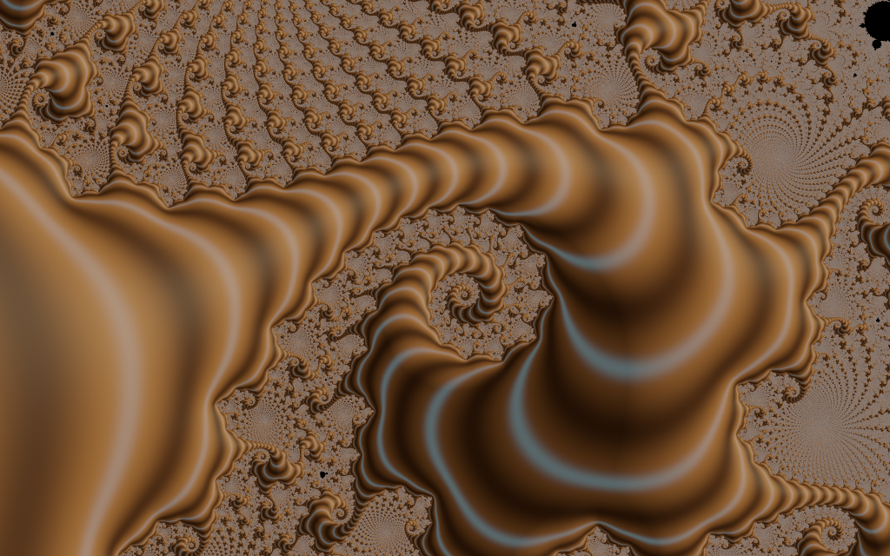

# POC evidence

2026-10-18. Real stored Mandelbrot samples, `1024x640`, ss=2; AMD Radeon RX 5700 XT (RADV NAVI10).

Warm wall time includes the final GPU readback and excludes sample math, initialization, PNG writing and MP4 encoding. Seven warm samples per branch: preliminary cost evidence, not a production throughput guarantee.

| Graph output | Warm p50 (ms) | Warm max (ms) | Dispatches | Estimated GPU buffers (MiB) |
|---|---:|---:|---:|---:|
| base | 5.38 | 5.82 | 2 | 55.50 |
| warp | 5.46 | 6.04 | 3 | 85.50 |
| relight | 6.10 | 7.14 | 4 | 105.50 |
| halo | 6.36 | 6.58 | 4 | 85.50 |
| all | 7.03 | 7.46 | 7 | 125.50 |

The full connected graph uses five image passes plus field rasterization/output encoding; three transient image slots; four retained pipelines; one sample upload. Its three final combining operations fuse into one kernel. Scalar/vector global controls use compact single-value storage. No per-frame pipeline or buffer allocation was observed.

Warp-before-relight and relight-before-warp changed 361581 output channels on the same input, with mean absolute channel difference 0.3473. The effect is local and can be subtle; it is actual signal order, not different preset code.

The 48-frame / 24 fps local motion demo replayed frame 24 exactly from time=1 and exposure=24. Encoded frames 0, 24 and 47 were decoded and inspected. Grain is off. These examples prove the engine scaffold; broad silk-like transport, optical glints and convincing pearlescence still need stronger primitives and art direction.

The machine-readable report includes input hashes, frame costs and decoded-frame error. The local reproducible run retains PNG sequences, MP4, commands, stdout/stderr and replay under `/home/juno/.fdv/fractodactyl/styling-poc/`; run `tools/research/looks/styling-poc.sh` with its documented environment to regenerate.

Checks: style CLI/GPU integration suite; complete fd-shade suite (24 passed; one fixture-regeneration test intentionally ignored); actual real-sample POC including unchanged input hashes and deterministic replay. Final Ishoo candidate checks rerun these on the exact landed tree.

The expanded test run initially exited with SIGSEGV. Isolation also exposed the explicit-class-mask bug described above, which was corrected. GPU fixtures now serialize their device lifecycles. The isolated classification/graph test and the full suite subsequently passed. No diagnosis of the driver is claimed.
